<p align="center">
  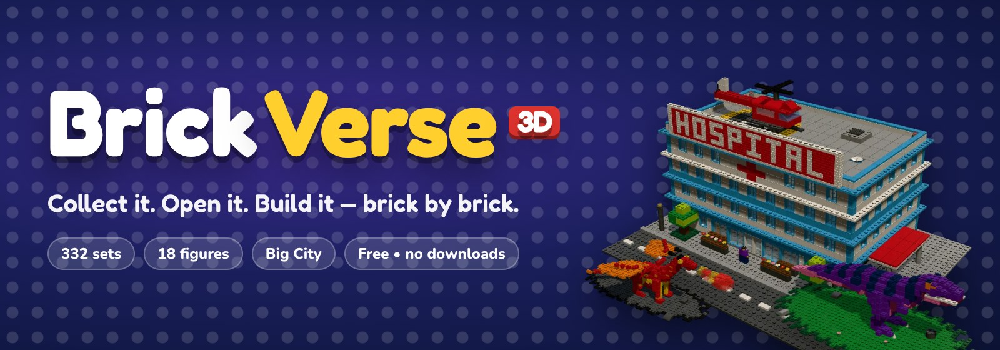
</p>

<h3 align="center">A cosy brick-building game that runs right in your web browser.</h3>

<p align="center">
  <b>Collect sets</b> 🛒 &nbsp;→&nbsp; <b>open the box</b> 📦 &nbsp;→&nbsp; <b>tear the bags</b> 🛍️ &nbsp;→&nbsp; <b>follow the booklet</b> 📖 &nbsp;→&nbsp; <b>build it in 3D</b> 🧱 &nbsp;→&nbsp; <b>show it off</b> 🏛️
</p>

<p align="center">
  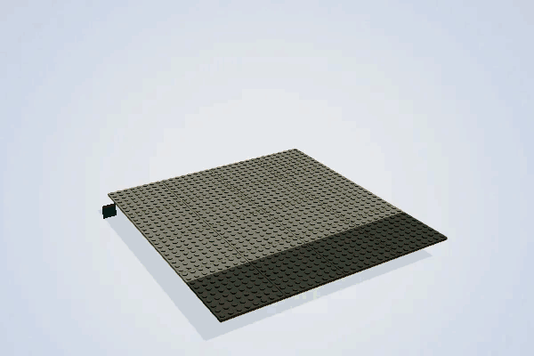
</p>

<p align="center">
  <code>332 sets</code> · <code>23 themes</code> · <code>18 figures</code> · <code>91 part types</code> · <code>25 colours</code> · <code>live 3D</code> · <code>no downloads</code> · <code>no accounts</code> · <code>free</code>
</p>

---

## ✨ Highlights

<table>
  <tr>
    <td width="50%" valign="top">
      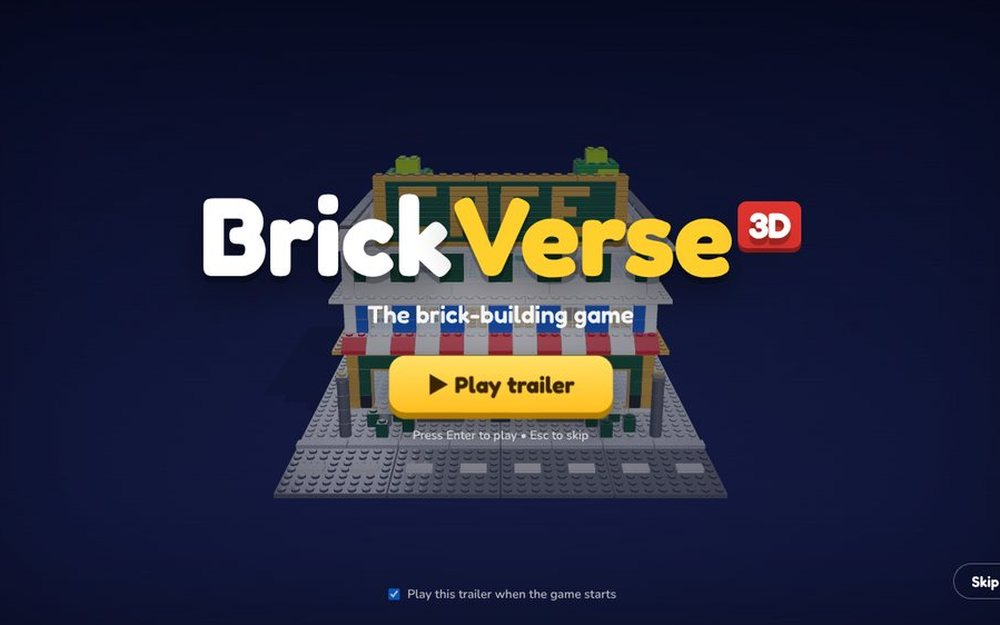<br>
      <b>🎬 A trailer every time you start</b><br>
      A 30-second, upbeat intro that plays live in the game's own 3D engine. Press <kbd>Enter</kbd> to watch, <kbd>Esc</kbd> to skip.
    </td>
    <td width="50%" valign="top">
      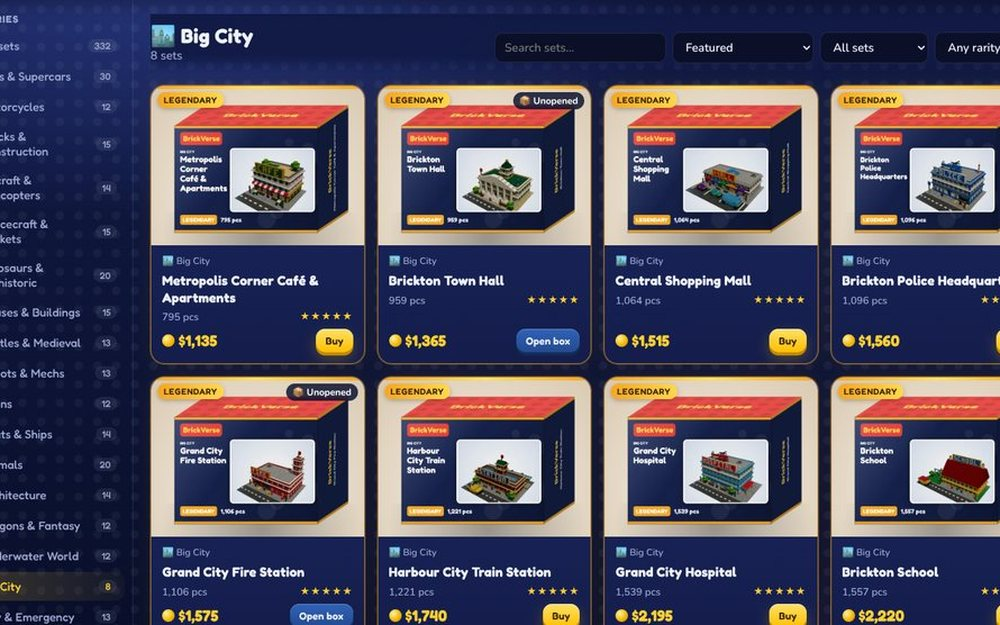<br>
      <b>🛒 332 sets to collect</b><br>
      Cars, dinosaurs, dragons, castles, rockets, theme-park rides, and giant <b>Big City</b> buildings, each with its own box art.
    </td>
  </tr>
  <tr>
    <td valign="top">
      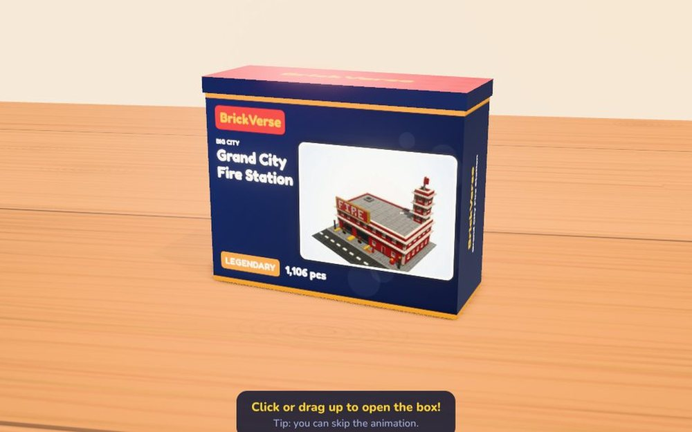<br>
      <b>📦 Open real boxes on your desk</b><br>
      Lift the lid and out pop the numbered bags and the instruction booklet.
    </td>
    <td valign="top">
      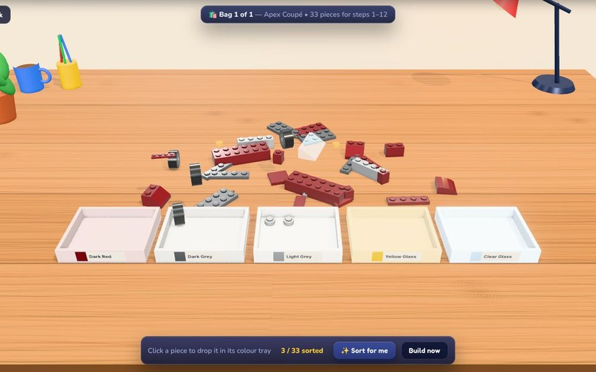<br>
      <b>🛍️ Tear the bags &amp; sort the pieces</b><br>
      Pieces tumble onto the desk, then you click them into colour trays (or press <i>Sort for me</i>).
    </td>
  </tr>
  <tr>
    <td valign="top">
      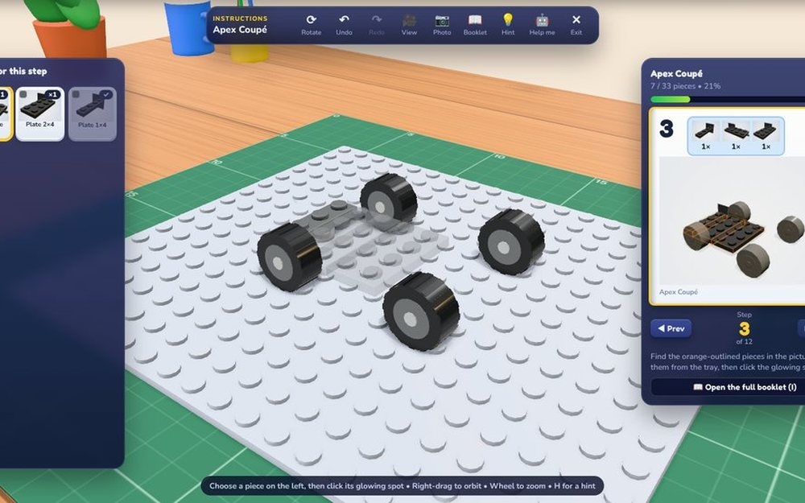<br>
      <b>🧱 Build it brick by brick</b><br>
      Glowing targets show where each piece goes. Bricks drop, squash and <i>click</i> onto the studs with sparkles and sound.
    </td>
    <td valign="top">
      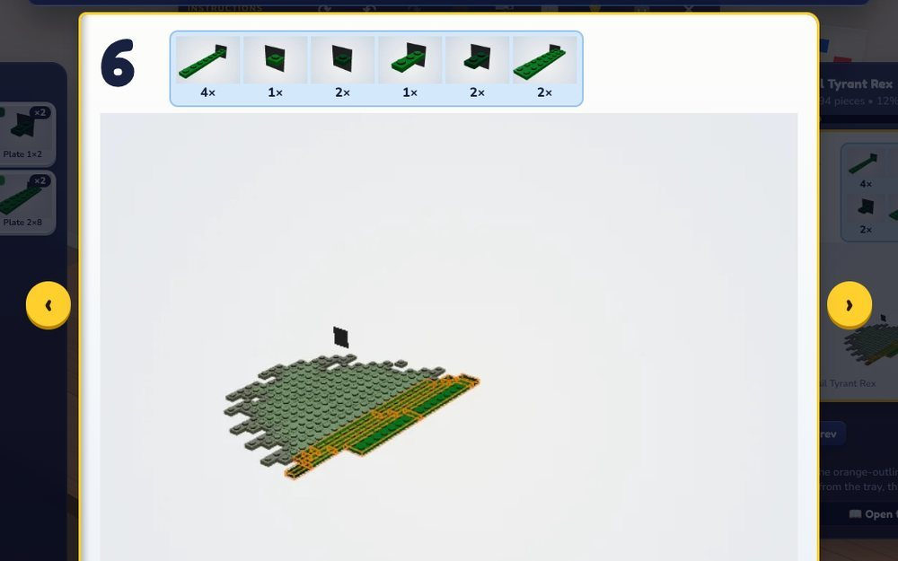<br>
      <b>📖 A booklet for every set</b><br>
      Cover, numbered steps with parts call-outs, a parts list, and page turns. Open it any time with <kbd>I</kbd>.
    </td>
  </tr>
  <tr>
    <td valign="top">
      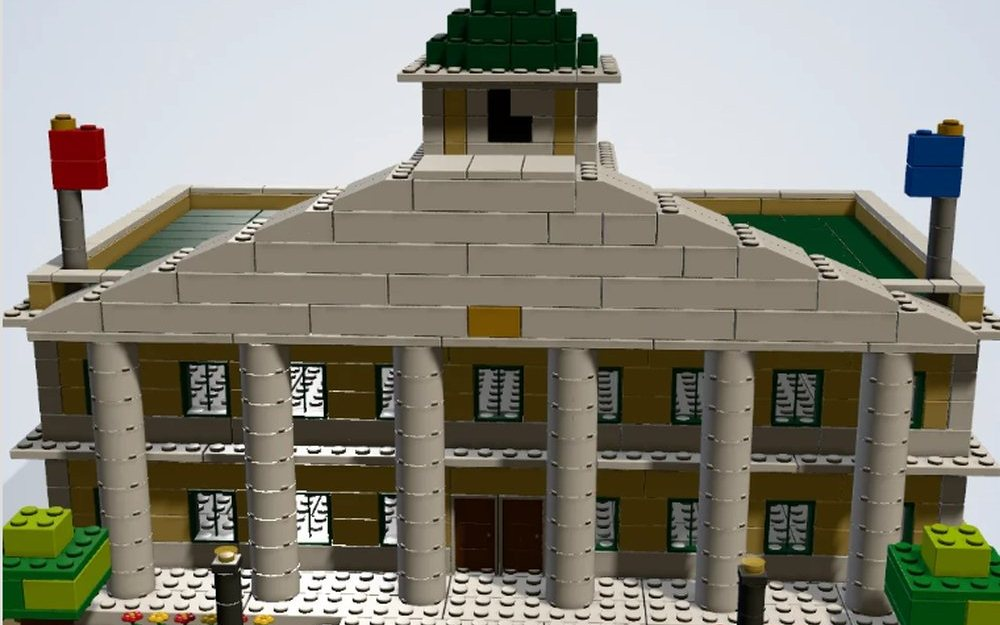<br>
      <b>🏙️ Big City</b><br>
      8 huge buildings: a fire station, hospital, police HQ, town hall, train station, mall, school and café. They're furnished inside, with neat windows that line up.
    </td>
    <td valign="top">
      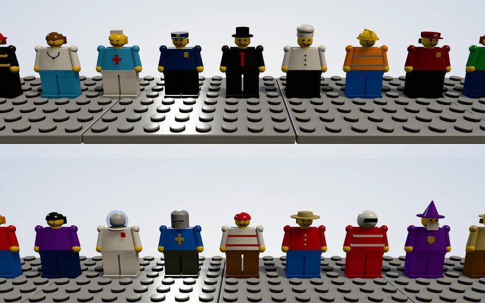<br>
      <b>🙋 18 little figures</b><br>
      Firefighters, doctors, nurses, police, a mayor, a chef, teachers, kids and more live in the Big City buildings, inside and out.
    </td>
  </tr>
  <tr>
    <td valign="top">
      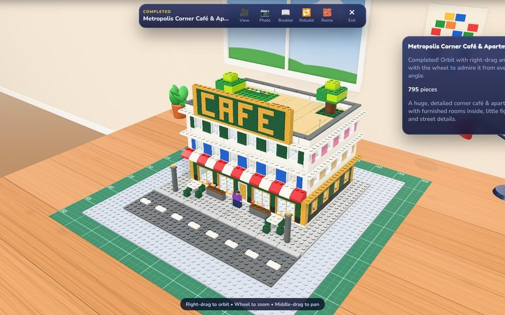<br>
      <b>🏆 Finish it &amp; admire it</b><br>
      Spin your finished model on the desk, take photos, then put it on the shelves in your Display Room.
    </td>
    <td valign="top">
      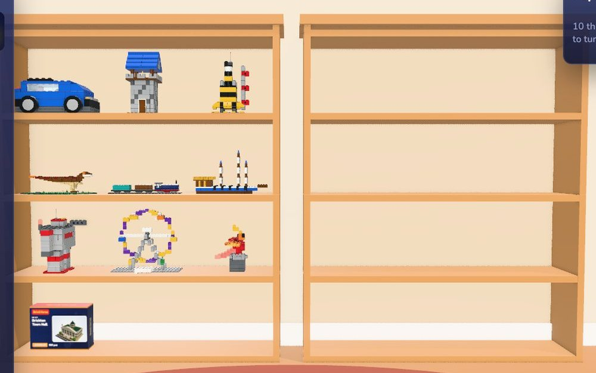<br>
      <b>🏛️ Your own Display Room</b><br>
      Finished builds go up on big wooden shelves, and sealed boxes can too. Move them around, turn them, and open more rooms as you collect.
    </td>
  </tr>
</table>

---

## 🚀 Put it online with GitHub Pages (free)

1. Go to **github.com** and sign in.
2. Click **+** (top right) → **New repository**. Name it e.g. `brickverse`. Make it **Public**. Click **Create repository**.
3. On the new repo page click **uploading an existing file**.
4. Open the unzipped `brickverse` folder on your computer, select **everything inside it**
   (`index.html`, `styles.css`, `src`, `vendor`, `assets`, `docs`, `tools`, `README.md`, `.nojekyll`, …) and drag it onto the page.
   *(Tip: `.nojekyll` is a hidden file. On Windows, turn on View → Show → Hidden items so you can see it.
   If it doesn't upload, the game still works.)*
5. Click **Commit changes** and wait for the upload to finish.
6. Go to **Settings → Pages**. Under **Build and deployment → Source**, pick **Deploy from a branch**.
   Choose branch **main** and folder **/ (root)**, then **Save**.
7. Wait 1–2 minutes and refresh the page. Your link appears at the top, like
   `https://YOUR-NAME.github.io/brickverse/`. Open it — that's your game! 🎉

To update the game later, upload the changed files again (same steps 3–5). Players keep their progress.

<details>
<summary><b>💻 Play it on your own computer instead</b></summary>

<br>

Browsers don't allow this kind of game to run by just double-clicking `index.html` (they block
"modules" from local files for safety). You need a tiny local web server. Pick **one** way:

**Option A — VS Code (easiest if you have it)**
1. Open the `brickverse` folder in VS Code.
2. Install the extension **Live Server**.
3. Right-click `index.html` → **Open with Live Server**.

**Option B — Python (Windows, Mac or Linux)**
1. Install Python from python.org (tick "Add Python to PATH" on Windows).
2. Open a terminal in the `brickverse` folder (in Windows Explorer: click the address bar, type `cmd`, press Enter).
3. Type `python -m http.server 8000` and press Enter.
4. Open **http://localhost:8000** in Chrome.

</details>

---

## 🎮 Everything in the game

| | |
|---|---|
| 🎬 **Start-up trailer** | 30 seconds of real sets, figures and brick drops with an upbeat soundtrack made by the browser (no video or music files). **Skip** or <kbd>Esc</kbd> to jump straight in. Switch it off on its title card or in Settings; replay it from the menu. |
| 🛒 **Brick Store** | 332 sets in 23 categories. Search, sort and filter by rarity, price or what you can afford. Hover a box to peek at the model inside. |
| 📦 **Opening boxes** | The box sits on your wooden desk. Click or drag up: the lid flies off, the bags and booklet pop out. Skippable. |
| 🛍️ **Bags & sorting** | Every set comes in numbered bags. You open bag 2 when the booklet reaches the bag 2 steps, just like a real set. |
| 📖 **Instruction booklets** | Cover, one page per step (parts call-out + picture with the new pieces outlined), a "Finished!" page and a parts list. |
| 🧱 **Building** | 3D desk workspace with snap-to-grid studs, ghost preview, rotation, colours, undo/redo and glowing targets. Bricks squash and bounce as they click on, with a puff of air, sparkles and a layered click sound. |
| 🙋 **Figures** | 18 original toy characters. They come with the Big City buildings, placed inside and out, and you can use all of them in the Build Studio. |
| 🎨 **Build Studio** | Free sandbox: 91 part types, 25 colours, multi-select, drag groups, duplicate, rotate, save/load, export/import JSON, screenshots. |
| ⭐ **Progress** | Money, XP & levels, daily rewards, 3 daily challenges, streaks, piece milestones, 27 achievements, rare → legendary sets. |
| 🏛️ **Display Room** | Big wooden shelves for your finished builds and sealed boxes: move them, turn them, take them down. More rooms open as you collect. |
| 💾 **Saving** | Automatic, in your browser. Download a backup file any time (Settings). |
| 🔊 **Sound** | All generated live by the browser. Separate music / effects volume and mute. |

<details>
<summary><b>🕹️ Controls</b></summary>

<br>

| Action | Mouse / key |
|---|---|
| Place a piece / select | **Left-click** |
| Move selected pieces | **Left-drag** (Select tool) |
| Orbit the camera | **Right-drag** |
| Zoom | **Mouse wheel** |
| Pan | **Middle-drag** or **Shift + right-drag** |
| Rotate piece / selection | **R** (Shift+R the other way) |
| Undo / Redo | **Ctrl+Z** / **Ctrl+Y** |
| Delete | **Delete** (selected pieces, or the piece under the mouse) |
| Duplicate | **Ctrl+D** |
| Place tool / Select tool | **B** / **V** |
| Select several | **Shift+click** |
| Pick up a piece & colour | **Alt+click** |
| Nudge selection | **Arrow keys**, **PgUp/PgDn** to lift |
| Hint (instructions) | **H** |
| Open the booklet / turn pages | **I**, then **← →** (or click the page) |
| Reset camera / Screenshot | **C** / **P** |
| Display Room: turn / move item | **Q/E** / **M** |
| Trailer: play / skip | **Enter** / **Esc** |

Right-drag is used for the camera so it never gets in the way of placing pieces with the left button.

</details>

---

## 💾 How saving works (no accounts!)

GitHub Pages only *shows* the game. It can't store anything. So each player's progress is saved **inside their
own browser, on their own computer**.

- 👤 **Everyone has their own save.** Friends who open your link start fresh and can't touch your progress.
- 💻 **A save belongs to one browser on one computer.** Another device starts from zero.
- 📤 **Moving a save:** **Settings → Download backup**, then **Restore backup** on the other device.
- ⚠️ **Clearing browser data or using a private window** loses (or doesn't keep) progress, and the game warns you.
- 🩹 If saved data is ever damaged, the game keeps a copy, starts fresh, and tells you.

## 🛡️ Safety

- **No network requests.** All code, the 3D library, fonts and icons are inside this folder: no CDNs, trackers,
  ads or analytics. A strict **Content-Security-Policy** in `index.html` blocks loading anything from other websites.
- **No API keys, accounts or personal data.** Nothing leaves your computer.
- **Imported files are checked.** Build and backup files are read as plain data (never run as code), size-limited, and
  every piece is validated: known part, known colour, whole-number position inside the build area, no overlaps.
- Text from files is always shown with `textContent`, never inserted as HTML.
- No real money. Everything is earned by playing.

---

<details>
<summary><b>🧠 How the 332 sets are made</b></summary>

<br>

The sets are **generated by code**, not hand-modelled one by one. There are 20 procedural "designers"
(cars, trucks, aircraft, dinosaurs, dragons, houses, castles, rides…) that combine reusable building
components. Together they produce **200+ distinct design styles**, and each set varies size, colours and
accessories on top of that. A test (`tools/validate-catalog.mjs`) proves **no two sets have the same shape**,
every instruction step points at a real piece, and no pieces overlap.

**Every piece holds on.** After a model is generated, a "repair" pass checks that each piece really clicks onto
studs (or has something clicked on top of it). Loose pieces are fixed the way a real builder would: joined into a
bigger piece, given a small post underneath, linked with a hidden plate, or nudged down onto the studs.

**Big City** buildings use a single window grid centred on the front, so windows, doors, garage bays, columns and
brick-built signs line up floor by floor. Street furniture is placed in mirror pairs, floors are two crossing plate
layers, and flowers grow in planters.

The finished model, the parts list and the instruction steps all come from **the same brick list**, so the
instructions can never ask for a piece that doesn't exist.

</details>

<details>
<summary><b>⚙️ Graphics & performance</b></summary>

<br>

- Bricks are drawn with **instanced meshes**: every piece of the same type and colour group is one draw call,
  so even 1,500-piece buildings stay smooth.
- Pieces outside the camera view are skipped (frustum culling), and very large models automatically use simpler studs.
- **Settings → Graphics:** Ultra (soft ambient-occlusion shading, glow on lights, smoothest edges, the default for
  gaming PCs), High, Medium, Low (no shadows/studs) for older PCs.
- Store thumbnails and box art are drawn only when visible, a few per frame, and cached in the browser.

</details>

<details>
<summary><b>🗂️ Project structure</b></summary>

<br>

```
index.html            page layout + security policy
styles.css            all styling
assets/               site icon and fonts
docs/readme/          the pictures on this page
vendor/three/         Three.js (MIT licence), the 3D engine, included so nothing is downloaded
src/main.js           start-up and error screen
src/game.js           central game object, top bar, screen switching, autosave
src/trailer.js        the start-up trailer and its soundtrack
src/engine.js         renderer, lights, shadows, effects, thumbnails
src/parts.js          every part type (including figures) and colour, the stud grid
src/geometry.js       procedural 3D shapes for each part type
src/brickRenderer.js  instanced drawing, picking, highlighting, ghosts
src/grid.js           collisions and "is it connected?" rules
src/models.js         model builder, repair pass, instruction steps, parts lists
src/generators/*.js   the procedural set designers (city.js = Big City)
src/catalog.js        builds all 332 sets (names, prices, rarity, unlocks)
src/store.js          Brick Store + Parts Shop
src/inventory.js      My Collection
src/boxOpening.js     box-opening scene
src/sorting.js        tearing bags open and sorting pieces into trays
src/bags.js           splits each set into numbered bags
src/building.js       Build Studio (instructions, free build, inspect)
src/instructions.js   step-by-step instruction logic
src/booklet.js        flick-through instruction booklets
src/boxArt.js         box artwork and 3D box pictures
src/desk.js           the wooden desk, lamp and props
src/effects.js        drop, bounce, sparkle and confetti effects
src/collectionRoom.js Display Room with shelves
src/progression.js    money, XP, levels, daily rewards, challenges, achievements
src/saveSystem.js     saving, loading, validation, backups, import/export
src/audio.js          generated sound effects and music
src/menu.js           main menu, settings, daily rewards, achievements, profile
src/ui.js             small interface helpers
tools/                developer checks and picture makers (not needed to play)
```

</details>

<details>
<summary><b>🧪 Developer checks</b></summary>

<br>

- `node tools/validate-catalog.mjs` builds every set and checks ids, names, unique shapes, overlaps and steps (`--list` prints the catalogue).
- `node tools/audit-all.mjs` lists any loose pieces or pieces that didn't fit, by the line of code that made them.
- `node tools/audit-city.mjs` runs the same check in more detail for the Big City buildings.
- `tools/preview.html`, `tools/closeup.html`, `tools/figures.html` and `tools/readme-media.html` (open through a local server) render sets, close-ups, the figures and the pictures on this page.

</details>

<details>
<summary><b>📝 Known limitations</b></summary>

<br>

- Hinges, technic pieces and wheels are decorative: they don't move or turn.
- The "connected" check looks at each piece and its neighbours, not whole sections.
- Built for desktop with a mouse (Chrome on Windows is the main target). Touch screens aren't supported well.
- On very weak graphics chips, the first visit to the store takes a moment to draw thumbnails (they're cached afterwards).

</details>

---

## 💛 Credits & licence

- Game code: MIT licence (see `LICENSE`).
- [Three.js](https://threejs.org) by the three.js authors, MIT licence (`vendor/three/LICENSE`).
- Fonts: Fredoka and Nunito, SIL Open Font License (`assets/fonts/LICENSE-*.txt`), stored in the project so the game never downloads anything.
- All set designs, figures, names, box art, music and sounds are original and generated by code. BrickVerse 3D is not
  affiliated with or endorsed by any toy company and uses no official logos, figures or set artwork.

<p align="center"><b>Happy building! 🧱</b></p>
